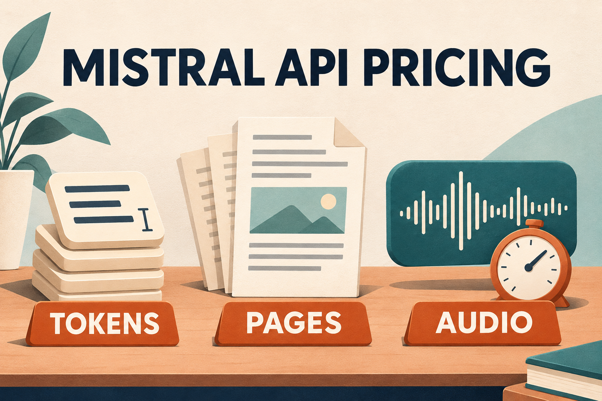

# Mistral API Pricing: What You Pay for Tokens, OCR and Audio

Pricing a document assistant or a transcription feature starts with a practical question: how much will the API cost? Mistral API pricing uses several meters. Text generation is charged for the text you send and the answer you receive. Document recognition and speech can use pages, minutes or characters instead.

For a text-only starting point, Mistral Small 4 lists $0.15 per million input tokens and $0.60 per million output tokens. Tokens are the pieces of text a model processes, rather than a fixed number of words. A document workflow may also need a separate page-processing charge before that model sees the extracted text.

The tables below give current published rates, followed by the billing and processing conditions that change an estimate. A worked document example shows how to add the steps without confusing a token quote with the whole bill.

*Different workloads use different meters. Conceptual illustration; rates and conditions are in the tables.*

In this guide: [Current text-model rates](#current-text-model-rates) · [OCR, embeddings and audio use different meters](#ocr-embeddings-and-audio-use-different-meters) · [API access and prepaid billing are separate questions](#api-access-and-prepaid-billing-are-separate-questions) · [Which adjustments can you actually use?](#which-adjustments-can-you-actually-use) · [A document workflow: price both steps](#a-document-workflow-price-both-steps) · [Check the provider behind the quote](#check-the-provider-behind-the-quote)

## Current text-model rates

These are published USD rates for **Standard processing on Mistral's global API**, checked on 6 November 2026. Input is what you send; output is what the model generates. Cached input is previously processed prompt content reused under the caching conditions explained below. All three price columns are per **one million tokens**. Source: [Mistral pricing](https://mistral.ai/pricing/api/), which currently redirects to its API pricing documentation.

| Model | Version shown | Input | Cached input | Output |
|---|---|---:|---:|---:|
| Ministral 3 3B | 25.12 | $0.10 | $0.01 | $0.10 |
| Ministral 3 8B | 25.12 | $0.15 | $0.015 | $0.15 |
| Ministral 3 14B | 25.12 | $0.20 | $0.02 | $0.20 |
| Mistral Small 4 | 26.03 | $0.15 | $0.015 | $0.60 |
| Mistral Large 4 | 26.10, public preview | $0.70 | $0.07 | $2.10 |
| Codestral | 25.08 | $0.30 | $0.03 | $0.90 |

This table covers the current Mistral-authored generalist models and Codestral, not every third-party model hosted on the platform. It compares prices, not task quality. A lower token rate only helps if that model completes your task with an acceptable output and retry rate.

Check the model version as well as the family name. The [Large 4 model card](https://docs.mistral.ai/models/mistral-large-4-0) labels it public preview. The [model lifecycle table](https://docs.mistral.ai/models) lists Medium 3.5 and Large 3 as deprecated from 31 October 2026, with retirement scheduled for 30 April 2027. Deprecated does not mean already retired, but check the current model lifecycle before using an older price roundup to choose a new integration.

## OCR, embeddings and audio use different meters

Optical character recognition (OCR) extracts information from document pages. Embeddings turn text or code into numerical representations for retrieval. Neither should be budgeted as though it were an ordinary text-generation response.

Selected published Standard, global USD rates, checked on 6 November 2026. These are regular rates before any eligible caching or Batch adjustment. Source: [capability pricing](https://mistral.ai/pricing/api/).

| Service | Billing unit | Published rate |
|---|---|---:|
| OCR 4.1 | 1,000 pages | $4.00 |
| OCR 3 | 1,000 pages | $2.00 |
| Mistral Embed | 1 million input tokens | $0.10 |
| Codestral Embed | 1 million input tokens | $0.15 |
| Voxtral Mini Transcribe 3 | Audio minute | $0.0035 |
| Voxtral Small Transcribe 3 | Audio minute | $0.004 |
| Voxtral Mini Transcribe Realtime 3 | Audio minute | $0.008 |
| Voxtral TTS 3 | 1 million characters | $13.00 |

Voxtral Small audio understanding has two meters: $0.004 per input audio minute and $0.40 per million generated text tokens. Do not apply a transcription-only minute price to that whole interaction.

The same boundary matters for documents. If you extract pages with OCR and then send the extracted text to a separate model for summarization, count the OCR pages and that subsequent model call. If you also create embeddings, add that step's input tokens. A price per page is not a promise that every later action on the extracted content is included.

## API access and prepaid billing are separate questions

A price table tells you the rate, but it does not tell you whether an account can use the API. Mistral's current [usage and limits documentation](https://docs.mistral.ai/admin/billing-usage/usage-limits) says Free mode includes Vibe and Studio usage, but does not include API access. Creating API keys and using the API requires billing activation and pay-as-you-go. Older descriptions of free API-key access should not override that current requirement.

At the same time, do not assume every API dollar is charged on top of a paid plan's allowance. The [subscription documentation](https://docs.mistral.ai/admin/billing-usage/subscriptions) says plans share included monthly usage across Studio, the API and Vibe Code. Included usage is consumed first; additional eligible usage draws from prepaid credits when pay-as-you-go is enabled. Pay-as-you-go is an extension of usage, not a separate API subscription.

For budgeting, distinguish the workload's value at published rates from the amount of additional credits it consumes. The latter depends on your plan, remaining allowance and settings. No single free allowance applies to every reader here.

The [billing documentation](https://docs.mistral.ai/admin/billing-usage/billing) also distinguishes spending limits from credit balance: limits apply before tax, while credits are deducted including tax. Credits can therefore run out before a spending limit is reached. A spending cap is not the same thing as an exact prepaid balance.

## Which adjustments can you actually use?

**Caching changes the input portion.** Repeated prompt content can be reused instead of processed afresh. For the Mistral-authored text models in the first table, the [prompt-caching documentation](https://docs.mistral.ai/inference/conversations/advanced/prompt-caching) prices cached tokens at 10% of the regular input rate. That is a 90% reduction on qualifying input tokens, not on the whole request. Output keeps its own rate, and a repeated prompt does not guarantee a cache hit.

To estimate text cost, use:

`cost = (uncached input tokens × input rate + cached input tokens × cached rate + output tokens × output rate) / 1,000,000`

The rates in this formula must all be per million tokens. Mistral reports cache hits in `usage.prompt_tokens_details.cached_tokens`; those tokens are already part of `prompt_tokens`, so subtract them to find uncached input. Do not charge the same cached tokens twice. The documentation describes 64-token cache blocks; prompts shorter than 64 tokens do not qualify.

**Batch trades immediacy for price.** The [Batch documentation](https://docs.mistral.ai/inference/batch-processing) offers a 50% discount for supported asynchronous jobs, including OCR and chat completions. This suits a backlog processed after upload, rather than a live answer a user is waiting for. Jobs have a default 24-hour timeout; this is an expiration setting, not a promise of completion at a particular time. Mistral also warns that high-throughput Batch usage may slightly exceed a workspace spending limit.

**Priority is a different paid mode.** The [Priority documentation](https://docs.mistral.ai/inference/priority-tier) specifies 1.75 times Standard token rates, including cached input after its cache discount. Enterprise setup and entitlement are required. With `service_tier: auto`, an eligible request can fall back to Standard; the returned usage tier determines billing. For a budget, use the tier actually returned rather than assuming every eligible request receives Priority pricing.

**A chosen region changes both price and available features.** The [regional inference documentation](https://docs.mistral.ai/inference/regional-inference) specifies a 10% premium for its supported input, output and cache charges. Regional endpoints do not support Batch. If your workflow needs regional processing, the global Batch estimate below is not an available combination. Model availability also varies by region.

## A document workflow: price both steps

Suppose you are costing a document-processing backlog. The application first extracts **10,000 pages with OCR 4.1**, then sends the extracted content to **separate Mistral Small 4 calls** (`mistral-small-2603`). Assume those later calls use **30 million input tokens and 3 million output tokens**, with no cache hits.

Those token quantities are planning assumptions, not a conversion rule from pages and not a measured customer workload. Using the Standard global USD rates above:

| Separately billed step | Calculation | Estimated usage cost |
|---|---|---:|
| OCR 4.1 | 10,000 ÷ 1,000 × $4.00 | $40.00 |
| Small 4 input | 30 × $0.15 | $4.50 |
| Small 4 output | 3 × $0.60 | $1.80 |
| Total | $40.00 + $4.50 + $1.80 | $46.30 |

If both steps can run as supported [global Batch processing](https://docs.mistral.ai/inference/batch-processing) jobs, price each at half its Standard rate: $20.00 for OCR, $2.25 for text input and $0.90 for output, totaling **$23.15**. OCR and chat are separate jobs; this is not a claim that a Batch job automatically performs the whole pipeline.

These totals are before tax, retries, tools, storage or any embeddings step. They also do not subtract a plan allowance or account credit. The figure to carry into a planning discussion is therefore “$46.30 in Standard usage under these assumptions,” not “the next invoice will be $46.30.”

Page extraction accounts for $40 of this $46.30 estimate. Reducing text input alone cannot remove that page charge. Before choosing a model on token price, verify the expected page count, extracted-text volume, output length and whether Small 4 actually meets the task's quality requirements.

## Check the provider behind the quote

The model name does not identify the company billing you. An aggregator can publish its own rate for access to a Mistral model. For Large 4, the following are current public USD quotes per million tokens, checked on 6 November 2026:

| Quoting provider and scope | Input | Cached input | Output |
|---|---:|---:|---:|
| [Mistral](https://mistral.ai/pricing/api/) — Standard, global | $0.70 | $0.07 | $2.10 |
| [Moduck](https://moduck.ai/models/c/mistral/mistral-large-4) — published Large 4 model-page quote | $0.544 | $0.056 | $1.672 |

Moduck lists the model identifier `mistral/mistral-large-4`. Its public panel supplies the three rates above, but does not identify a selected upstream serving provider or spell out the cache-hit conditions and processing-mode terms needed for a fully matched comparison. “Model lab: Mistral” identifies the model's origin; it does not resolve those route details.

Both rows are published prices, not measured account bills. Moduck's listed numbers are lower than the corresponding Mistral Standard numbers here; that does not establish identical service, eligibility or total cost. Its [Moduck billing page](https://moduck.ai/pilot/pricing) lists a $10 minimum top-up and no fixed monthly fee. A top-up is prepaid balance, not the price of this document example or a guarantee about model access.

Choose a route after checking the exact model, feature support, cache rules and billing terms against your workload. If Moduck fits your model, interface and billing requirements, the next step is to [Get API Key](https://moduck.ai/dashboard/api-keys). Sign-in required.
